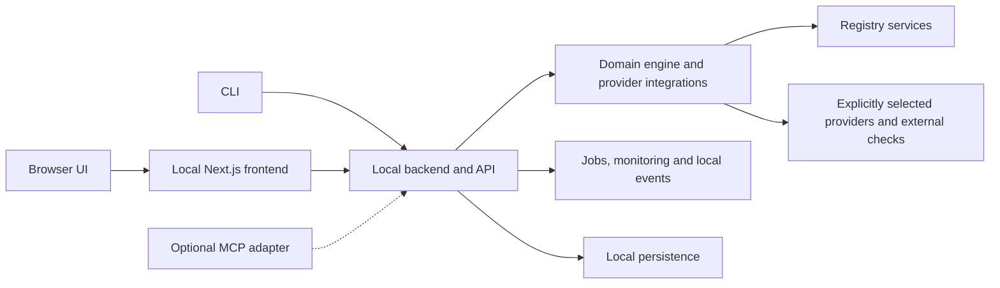

# Domain Scout plan

Status: the product scope, local application fundamentals and Go/NestJS/Next.js stack are finalized for handoff. [PRODUCT.md](PRODUCT.md) defines what to build; [TECH_STACK.md](TECH_STACK.md) records the selected technologies; [BUILD_HANDOFF.md](BUILD_HANDOFF.md) defines contracts, modules, storage, CLI operations, references and verification. There are no effort estimates or release phases. Visual design is explicitly outside this planning pass. No blocking planning questions remain; application coding awaits Piyush's instruction to the implementing agent.

This baseline remains open to additions and refinements from the technical discussion. Finalizing the written plan does not freeze the product vision or divide it into a reduced release scope.

## Product we intend to build

Domain Scout is a local domain-discovery and purchase-research tool for coding agents and Piyush. The CLI is the primary agent interface; a complete new browser UI serves the same workflows. MCP is an optional adapter that can be added afterward. The product helps users turn a candidate list into sourced registry results, compare purchase options and costs, and hand off to the matching external checkout destination.

| Capability | Scope |
| --- | --- |
| Availability | Direct registry checks wherever public sources permit, including `.si`; validation, internationalized names and multi-label registration boundaries |
| Bulk discovery | Import, extension expansion, progress, cancellation, recovery, resume and selective retries |
| Providers | Hostinger, Dynadot, Porkbun, Namecheap, GoDaddy, Cloudflare Registrar, Spaceship, NameSilo and Name.com; extensible regional directories |
| Pricing | Catalogs, supported exact-name quotes, registration, renewal, transfer, premiums, promotions, terms, currencies and ownership estimates |
| Naming | Local candidate generation, editable selections, extension presets and saved criteria |
| Results | Search, filters, shortlists, notes, history, evidence, rechecks and scoped exports |
| Monitoring | Explicitly configured availability and price watches with local notices and retained change evidence |
| Price history | Observed prices with comparable terms, gaps and source timestamps |
| Other purchase paths | Sourced aftermarket listings and read-only transfer or portfolio comparisons |
| Optional enrichment | Social, GitHub and package-name checks; DNS, DNSSEC, TLS and website diagnostics |
| Sharing | Local snapshots with selected data and privacy controls |
| Interfaces | Full human UI and non-interactive CLI, with consistent essential behavior; optional MCP adapter |

Every capability in this table belongs to the complete build scope. Optional means a user chooses whether to run the operation, not that it is assigned to another phase. These are planned capabilities, not a claim that they already work.

MCP is the explicit interface exception: Piyush suggested it as a possible addition afterward. It is not a dependency for the CLI, UI or complete product workflows and does not block development.

## Local application fundamentals

The CLI, backend, frontend and storage run on the user's own computer. Next.js serves the browser frontend and calls the local NestJS API. Nest owns jobs, persistent state, the domain engine and integrations. The Go CLI calls that same API. These are parts of one local application with separate local frontend/backend processes; no remote application server, hosted database or cloud scheduler is required. Supported OS families are macOS, Windows and Linux.

| Fundamental | Decision |
| --- | --- |
| Backend ownership | One local backend owns job execution and data changes; interfaces use its API rather than starting independent scanners or writing directly to its storage |
| Startup | A UI launcher starts or connects to the backend and opens the browser; the CLI connects to the same backend and starts it when needed without requiring the UI |
| Local access | Bind to loopback by default and restrict access to intended local clients; this is a single-user application with no public accounts |
| Shared behavior | Domain normalization, evidence, provider capability, pricing and errors are defined once and reused across interfaces |
| Persistence | Retain shortlists, jobs, results, settings, watches and observed prices in local application data; keep candidate data and credentials out of the source repository |
| Storage access | Nest manages SQLite through better-sqlite3, migrations and deliberate deletion; clients never write the DB |
| Job lifecycle | Submitted jobs have stable identifiers and inspectable status; cancellation stops new work, retains completed evidence and identifies unfinished items |
| Recovery | After interruption, mark unfinished work accurately and expose explicit resume; retain source times and applicable cooldowns rather than replaying completed checks |
| Monitoring | Watches run while the backend is active, including when the UI is closed; sleep, shutdown and process downtime create visible missed checks |
| External networking | Live registry queries need connectivity; provider quotes and optional checks reach only the explicitly selected destinations |
| Local diagnostics | Job and source errors are inspectable locally; routine logs omit credentials and avoid recording complete candidate lists by default |
| Optional MCP | Wrap existing backend capabilities and job state; do not create a separate engine, credential store or scheduler |

Persistence is needed for retained work, recovery and monitoring. It is local disk storage with no database hosting subscription. Selected libraries, runtime and packaging are recorded in [TECH_STACK.md](TECH_STACK.md), with compatibility and distribution limits identified.

## End to end workflows

1. Supply or generate names, choose extensions, validate input and preview expanded unique checks.
2. Start a registry-only batch, inspect partial results and recover interrupted work.
3. Filter results and save candidates into named shortlists with notes and retained evidence.
4. Inspect provider capabilities and published prices, then request supported exact-name confirmations or quotes from selected providers.
5. Compare registration and renewal terms, fees and ownership estimates; refresh old evidence and open the matching purchase destination.
6. Restore saved criteria and history, inspect observed price changes, or configure selected watches.
7. Request optional naming or registration diagnostics, or inspect a separate aftermarket or transfer path.
8. Export an explicit selection or save a local result snapshot. Coding agents can perform the same essential operations without interactive prompts.

## Product behavior is defined

The requirements specify independent registry evidence and provider confirmation, uncertainty states, partial failure handling, source timestamps, matching purchase links, comparison rules and privacy routing. No missing DNS answer, timeout or malformed registration response becomes an availability claim.

Catalogs can load without candidate names. Provider checks, quotes and other external enrichment run only when requested. Defined freshness defaults are 15 minutes for registry evidence and quotes, and 24 hours for catalogs, with earlier provider quote expiries honored. Observation times always remain visible and never imply a reservation. Ownership comparison defaults to a three-year estimate using current data. Monitoring is disabled until configured and defaults to daily checks while the local application is active. Full defaults are in [PRODUCT.md](PRODUCT.md#product-defaults).

Provider capability is recorded separately for extension support, links, published prices, confirmation and quotes. All nine named providers are in scope, but the tool advertises only independently verified capabilities. A missing quote API or inaccessible account does not make a provider disappear or change registry evidence.

Piyush has no registrar API credentials now. The default experience uses registry checks, verified purchase links and dependable public catalogs without keys. Optional key-based integrations can be configured, tested and disconnected through the application console/settings and CLI. No-key workflows do not depend on those integrations, and fixture-tested authenticated capabilities remain labeled live-unverified until access is supplied.

## Acceptance is defined

The product requirements contain 19 acceptance scenarios spanning local startup and state, bulk recovery, registry failures, provider capability, quote semantics, generation, saved criteria, monitoring, histories, optional checks, comparisons, exports, sharing, freshness and accessible UI behavior. They include a 1,000-domain validation workload without an arbitrary small-batch input cap.

The coverage validation set will include representative gTLDs, `.si`, a WHOIS-supported ccTLD, a multi-label namespace, an internationalized name and invalid, unsupported, restricted or reserved cases where source evidence permits. Record the actual tested names, sources and dates when validating. Discovery counts stay separate from proven support. The dated metadata measurement in [FINDINGS.md](FINDINGS.md) is not tested product coverage.

These are acceptance criteria for the build, not results achieved during planning. No universal speed, exact price coverage or guaranteed registrability is promised.

## Finalized tech stack

Piyush selected Go for the CLI, NestJS for the backend and Next.js for the frontend. Supporting engineering defaults are Node.js 24 LTS, Express under Nest, SQLite through better-sqlite3, validated Zod/OpenAPI contracts, a generated Go API client and SSE progress. The detailed choices and tradeoffs are in [TECH_STACK.md](TECH_STACK.md). Cobra is a parser default, not a user requirement. The complete product scope remains intact.

| Choice | Requirement it must satisfy |
| --- | --- |
| Language and runtime | Registry networking, WHOIS where needed, reliable long jobs and structured CLI output; allow an optional MCP adapter |
| Backend and API framework | Nest owns durable jobs and persistence, restricts local access and exposes consistent operations to Next and Go |
| UI framework and visual design | Complete workflows, usable large result lists, accessible controls and retained context |
| Storage | Batch recovery, collections, histories, credentials handling and deliberate deletion |
| Protocol and namespace libraries | Source discovery, IDN and suffix handling, honest negative responses and registry cooldowns |
| Provider integrations | Different account requirements, exact-name quote evidence, catalog freshness and isolated failures |
| Agent tooling | Versioned results, non-interactive operation, progress inspection, partial errors and capability parity |
| Packaging and distribution | Self-contained local use, optional provider credentials and no mandatory hosted service |

Exact compatible versions will be pinned during implementation. Domain/provider classifications and packaging still require verification. The Go CLI is compiled, while the full app needs Node and a native SQLite driver. Distribute all local assets together and test on macOS, Windows and Linux; a single runtime-free executable is not promised. Visual design is intentionally left out of this planning pass.

## Development handoff

The product and engineering plan are ready for the next coding agent. [BUILD_HANDOFF.md](BUILD_HANDOFF.md) specifies API/results/errors, jobs and recovery, SQLite tables, local startup/access, optional credentials, CLI commands, the public-project reference map and completion checks. There are no open product or stack decisions blocking implementation. Exact dependency versions, source fixtures and native package verification are implementation work.

Piyush will give the separate instruction to start building. That instruction supersedes the current planning-only restriction. Do not ask for settled scope/stack approval again. Functional frontend requirements remain included; visual layout was explicitly excluded from this planning task. Registrar live tests requiring keys remain unverified until configured, without blocking delivery of the no-key app and optional integration controls.

## Reuse and research

We will own the product behavior and UI while considering established libraries and inspected references. The source review covers 13 repositories and official documentation for nine providers. Only WhiteBite Domain Hunter was installed and exercised through UI, CLI and MCP; other advertised features remain documentation evidence.

- [Source review](SOURCE_REVIEW.md): pinned revisions, activity dates, feature ideas and evidence limits.
- [Reference map](REFERENCES.md): standards, provider documentation and code reference points.
- [Trial](TRIAL.md): observed behavior, candidate disclosure and UI, export and price-link gaps.

Before adopting code, confirm license files and notices, inspect outbound routing, and validate response classification and cooldown behavior. Historical fixture collections do not prove current registry support. No full upstream application or dependency tree is selected merely because its feature list is broad.

## Product boundaries

The tool researches and hands off purchases. Automated registration, payments, wallets, DNS changes, hosting deployment, drop-catching and trademark clearance are outside scope. Public hosting, remote synchronization and automatic uploads are not part of the local snapshot feature.

Registry discovery requires no paid aggregator or provider key. Optional provider integrations can require account access. Registry services and explicitly requested providers can observe their queries; zero logging and zero front-running risk are not guarantees.

## Planning history

| Date | Change |
| --- | --- |
| October 4, 2026 | Expanded the intended scope from .si to all feasible TLDs; researched existing tools and purchasing information |
| October 4, 2026 | Created Domain Scout to preserve findings and continue planning; no application implementation adopted |
| October 4, 2026 | Confirmed coding agents as the primary users and a UI for Piyush; expanded planning to pricing and purchase details; authorized a private repository |
| October 4-5, 2026 | Tried WhiteBite Domain Hunter locally through UI, CLI and MCP; recorded working behavior and gaps |
| October 5, 2026 | Chose our own product using existing references; required a complete UI redesign and broader provider coverage including Hostinger |
| October 5, 2026 | Reviewed 13 repositories and nine provider documentation sources; drafted a prioritized product requirement list before architecture decisions |
| October 5, 2026 | Completed the full product scope, defaults and acceptance scenarios without effort estimates or release phases; tech-stack discussion is next |
| October 5, 2026 | Confirmed local backend, browser UI, CLI and persistence; made MCP an optional subsequent adapter and defined shared local job ownership |
| October 5, 2026 | Researched current stack documentation and recorded a TypeScript, Node 24, Fastify, React/Vite and SQLite recommendation for review |
| October 5, 2026 | Piyush selected Go CLI, NestJS backend and Next.js frontend; finalized supporting defaults and cross-language API contracts |
| October 5, 2026 | Confirmed macOS/Windows/Linux, excluded visual design from this pass, and chose keyless defaults plus optional console/CLI registrar integrations; completed BUILD_HANDOFF.md |

## Repository and implementation status

The repository remains private during planning and implementation. Open sourcing requires Piyush's separate explicit instruction, even after an end-to-end product exists. Application implementation also requires an explicit instruction to begin. Research and authorized trial artifacts stay inside this project; the earlier external scaffold has not been adopted.
