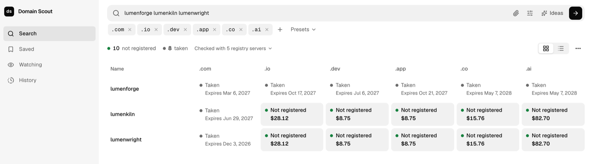
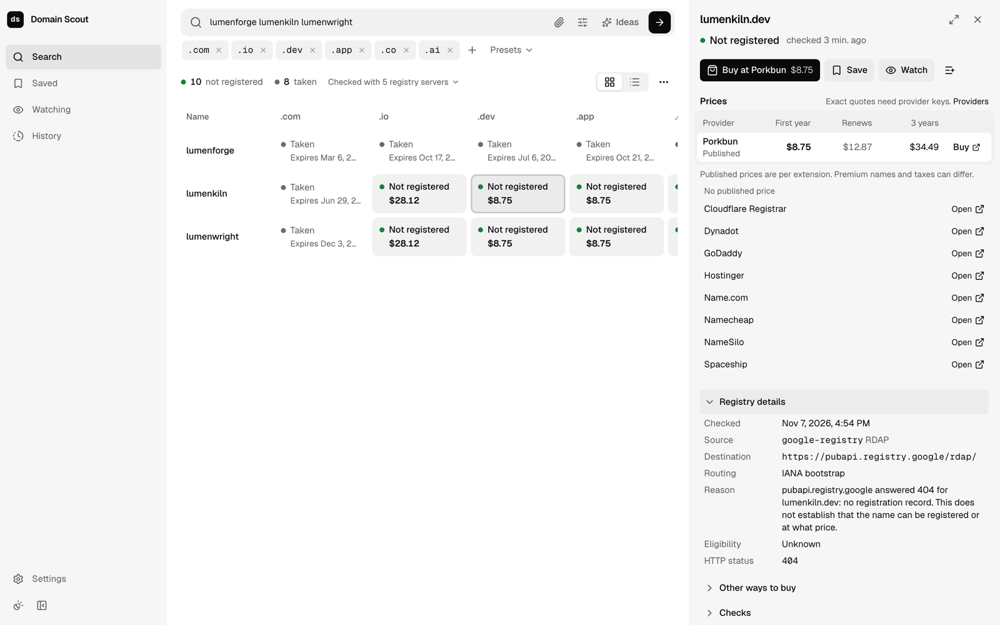

# Domain Scout

Local tool for checking domain registration records, finding purchase providers and comparing prices where reliable data exists. It is a CLI for coding agents first; an optional web UI drives the same local engine. Nothing is hosted. Independent project; not affiliated with any registry, registrar or marketplace.

Registry results are evidence, not promises: "no record" means the registry returned no registration record when checked, not that a name can be bought. Prices carry their source, type and age, and unknown values stay unknown.



## Install the CLI

The npm package is the whole CLI-only install: the Go CLI for your platform plus the local engine, with no UI. It needs Node.js 24.11 or newer. Install the tarballs from the [latest release](https://github.com/piyush-gambhir/domain-scout/releases/latest), which also lists their `SHA256SUMS`; the packages are not on the npm registry.

```sh
v=0.1.0
base=https://github.com/piyush-gambhir/domain-scout/releases/download/v$v
npm install -g "$base/domain-scout-$v.tgz" "$base/domain-scout-cli-$(node -p 'process.platform+"-"+process.arch')-$v.tgz"
domain-scout scan acme --tlds com,io --wait
```

There is no server to run. The first command starts the engine in the background, later commands reuse it, and it stops itself after ten idle minutes (`DOMAIN_SCOUT_IDLE_TIMEOUT` in seconds, `0` to keep it running). Active watches, unfinished jobs, session-only provider keys and a running UI keep it up. A newer CLI replaces an older engine once nothing would be lost.

To build and install the tarballs from a checkout instead:

```sh
pnpm install && pnpm build
node scripts/package-npm.mjs              # release/npm/*.tgz for macOS, Linux and Windows
npm install -g --offline release/npm/domain-scout-0.1.0.tgz release/npm/domain-scout-cli-$(node -p 'process.platform+"-"+process.arch')-0.1.0.tgz
```

`node scripts/verify-npm-package.mjs` checks an install end to end without sending any names.

## Run with Docker

```sh
docker compose up --build
```

Open the sign-in link printed in the logs (single use, valid 15 minutes). For a new link:

```sh
docker compose exec domain-scout open-url
```

The UI is published on `http://localhost:3000` only (loopback). The backend stays inside the container. Data persists in the `domain-scout-data` volume. Use another port with `DOMAIN_SCOUT_PORT=3100 docker compose up`.

The CLI is available inside the container:

```sh
docker compose exec domain-scout domain-scout scan acme --tlds com,io --wait --output table
```

## Run from source

Requires Node.js 26, pnpm 12 and Go 1.27 for development.

```sh
pnpm install
pnpm dev          # builds shared packages, runs backend and web in watch mode, opens a signed-in UI
```

`pnpm dev` keeps its state in `.dev-data/` so it never touches your real application data.

Build everything and use the CLI against the default data directory:

```sh
pnpm build
apps/cli/bin/domain-scout service start
apps/cli/bin/domain-scout ui
```

Useful Turborepo tasks: `pnpm typecheck`, `pnpm lint`, `pnpm test`, `pnpm test:e2e`, `pnpm generate` (OpenAPI and the Go client). `pnpm smoke` checks the CLI, API and web against one backend; `pnpm acceptance` runs 1,200 names twice through the real CLI and backend against a local stub registry (cancel, resume, restart, export) without sending names anywhere. `pnpm package` builds release archives with the UI for macOS, Linux and Windows into `release/` (Node.js 24.11 or newer must be installed on the target machine); `node scripts/package-npm.mjs` builds the CLI-only npm packages.

## CLI for agents

JSON by default (the API envelope with `contractVersion`), `--output table`, or `--output ndjson` (one object per line, each carrying `contractVersion`). Data goes to stdout; progress and errors go to stderr. Commands never prompt. `pnpm smoke` runs an end-to-end check of the CLI, API and web against one backend (it scans only fixed test names).

A scan with table output (the first two lines are progress on stderr):

```console
$ domain-scout scan lumenkiln --tlds com,io,dev,app,co,ai --wait --output table
Submitted job a69ca996-de0f-4020-aab7-468c0bbe908f (registry_scan).
completed: 6/6 finished, 0 unresolved
SUBJECT        OPERATION  TARGET  STATE     OUTCOME     RESOLVED  CHECKED                   BEST PRICE  ERROR  RETRY AT
lumenkiln.com  registry   -       finished  registered  true      2026-11-07T11:24:14.757Z  11.81 USD   -      -
lumenkiln.io   registry   -       finished  no_record   true      2026-11-07T11:24:16.077Z  28.12 USD   -      -
lumenkiln.dev  registry   -       finished  no_record   true      2026-11-07T11:24:15.871Z  8.75 USD    -      -
lumenkiln.app  registry   -       finished  no_record   true      2026-11-07T11:24:16.859Z  8.75 USD    -      -
lumenkiln.co   registry   -       finished  no_record   true      2026-11-07T11:24:15.525Z  15.76 USD   -      -
lumenkiln.ai   registry   -       finished  no_record   true      2026-11-07T11:24:16.891Z  82.70 USD   -      -
```

`CHECKED` is when the registry answered; fresh observations (15 minutes by default) are reused unless you pass `--recheck`. `BEST PRICE` is the lowest known first-year price for the extension from provider catalogs, never a quote.

```sh
domain-scout input preview --file names.txt --tlds com,io        # validate and expand, no network
domain-scout scan --file names.txt --tlds com,io --wait          # registry lookups only
domain-scout jobs results <job-id> --outcomes no_record --all
domain-scout quote example.com --providers porkbun --wait         # explicit provider disclosure
domain-scout export --scope filter --job <job-id> --outcomes no_record --format txt --out names.txt
domain-scout prices published com io si --years 3                 # catalog prices per extension, no names sent
```

Exit codes: 0 success, 1 local failure, 2 invalid usage, 3 completed with unresolved items, 4 provider access missing, 5 backend setup or version failure, 130 interrupted wait. Run `domain-scout --help` for the full command tree.

`domain-scout ui --job <job-id>` opens a CLI run in the UI. Runs started from the CLI, the UI, the API or a watch are labeled with their origin, so History shows agent runs next to your own searches.

### MCP

`domain-scout mcp` serves the same API as MCP tools over stdio (`scan`, `job_results`, `domain_evidence`, `suffix_prices`, `quote`, `shortlist_add` and more). Register it in an MCP client with the command `domain-scout` and args `["mcp"]`; see [apps/cli/README.md](apps/cli/README.md).

## Using the UI

| Page | For |
| --- | --- |
| Search | Type names or paste a list. Few names show as a name by extension grid, long lists as grouped results (Not registered, Taken, Couldn't check) with prices from the provider catalogs. Ideas mode generates candidates locally. |
| Saved | Shortlists with fresh status, cost over several years by provider, quotes and Buy links |
| Watching | Watched names and an inbox of changes (expiry, status, price) |
| History | Recent searches from the UI and from agents, to reopen, resume or retry |
| Settings | Provider keys, preferences (default extensions, currency, horizon), checks, coverage, data and service |

"Not registered" means the registry had no record when checked. Confirm with a provider before buying.



## Provider keys

Registry discovery and public catalogs need no keys. Optional provider integrations (exact checks and quotes) are configured in the UI under Providers, with `domain-scout providers configure`, or with environment variables such as `DOMAIN_SCOUT_PORKBUN_API_KEY`. Saved keys live in an owner-only file outside SQLite and are never returned by the API. Authenticated adapters are tested against documentation-derived fixtures only until real keys are supplied.

## Repository layout

| Path | What it is |
| --- | --- |
| `apps/backend` | NestJS 12 backend: jobs, registry lookups, providers, pricing, monitoring, exports, SQLite (`node:sqlite`) |
| `apps/web` | Next.js 16 UI; forwards `/api/v1` to the backend |
| `apps/cli` | Go CLI (`domain-scout`) with a client generated from the OpenAPI document |
| `packages/contracts` | Zod schemas, route table and the generated `openapi.json` |
| `packages/api-client` | Typed TypeScript client |
| `scripts` | Dev launcher, container entry point, release archives, npm packages, smoke and acceptance runs |

## Project notes

- [Build report](docs/BUILD_REPORT.md): what was built, how it was verified, and what is still pending.
- [Implementation guide](docs/IMPLEMENTATION.md): module ownership, contracts, runtime protocol and conventions.
- [Product requirements](docs/PRODUCT.md): scope, defaults and acceptance scenarios.
- [Build handoff](docs/BUILD_HANDOFF.md): contracts, modules, data, commands and verification plan.
- [Tech stack](docs/TECH_STACK.md): selected technologies and the build-time decisions.
- [Plan](docs/PLAN.md), [Findings](docs/FINDINGS.md), [Source review](docs/SOURCE_REVIEW.md), [Trial](docs/TRIAL.md), [References](docs/REFERENCES.md): research and planning record.
- [Agent instructions](AGENTS.md): boundaries for anyone continuing the work.
- [Contributing](CONTRIBUTING.md) and [security policy](SECURITY.md).

## License

[MIT](LICENSE).
